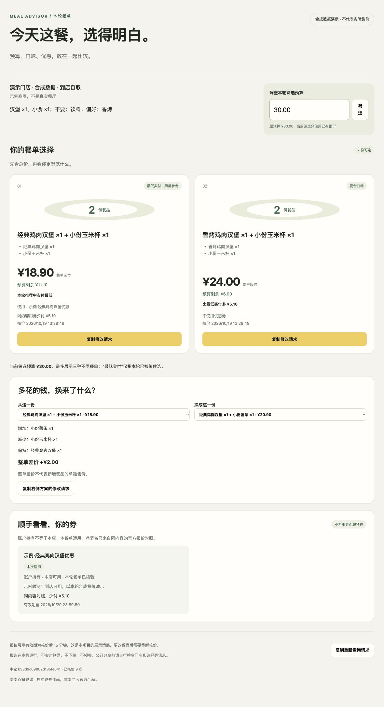

# 麦麦点餐参谋 · v0.1.0

把“怎么买划算”“预算内选哪餐”“手里的券值不值得用”放进同一次点餐。

**当前版：单人、同店、即时到店自取；真实查价和建议，不创建订单、不领券、不兑换积分。** 独立参赛作品，非麦当劳官方产品。

目标用户：希望先定预算、比较餐单、再决定是否用券的单人到店取餐用户。



项目仓库：[JeffreyDeng-spec/mcd-meal-advisor](https://github.com/JeffreyDeng-spec/mcd-meal-advisor)。

参赛申请：[官方 Issue #882](https://github.com/M-China/mcd-developer-innovation-challenge/issues/882)，实际报名状态见官方回复。

## 先看演示

运行 `python3 examples/demo.py` 后直接打开 [docs/demo.html](docs/demo.html)。所有门店、价格和券均为合成数据，不需要 Token、不联网。网页支持预算筛选、餐单差价对比、券体检及复制修改请求；比较区可查看所有预算内有效报价，推荐卡最多三张；改餐在 AI 对话中完成并重新核价。

```sh
python3 -B examples/demo.py
open docs/demo.html
```

## 安装技能

需要 Python 3.9+ 和支持麦当劳远程 MCP 的 AI 客户端。Python 与报告均零第三方运行依赖。

1. 按[麦当劳官方指南](https://github.com/M-China/mcd-mcp-server)配置 MCP，Token 仅填客户端私有配置。配置示例里的 `${MCD_MCP_TOKEN}` 需要客户端支持变量替换，或由用户在私有设置里填写；本项目脚本不读取环境变量或任何 Token 文件。
2. 完整复制 `skills/mcd-meal-advisor` 文件夹到客户端技能目录。Codex 可使用 `~/.agents/skills/` 或 `~/.codex/skills/`；WorkBuddy 等客户端用自身技能导入入口，不要只复制 SKILL.md。
3. 在新会话明确调用 `mcd-meal-advisor`，或让 AI 读取该目录的 SKILL.md。安装操作不修改 MCP 配置。

安全安装命令（目标已存在时停止，避免覆盖用户文件）：

```sh
python3 install.py --target ~/.agents/skills
```

## 一句话使用

> 使用麦麦点餐参谋。一个人，上海人民广场附近，现在到店取餐，30元以内，要一个鸡肉汉堡和一份小食，不要饮料。先让我选门店，再比较真实核价方案，顺便看看当前券包。不要下单或领券。

AI 会让你选店，查询当前菜单，生成最多20个核价任务，并把合格候选归为最多三种不同餐单。你可以说“保留汉堡，把这份小食换成玉米杯”；它检查原要求并对完整餐单重新核价。

网页报告调整预算只筛已有报价。提高预算后需要更多新方案，可复制重新查询请求回到聊天。报价展示有效期默认15分钟，是本项目策略；过期报价仅供回看。

## 实现和验证

- AI：理解需求、调用宿主现有只读 MCP、解释结果。
- Python：解析成功信封、检验预算与份数、生成候选、记录指纹绑定的官方报价、比较同购买结构用券效果、生成脱敏报告。
- HTML/JavaScript：单文件本地交互，不发业务请求。所有动态文本使用 textContent；JSON 按脚本上下文转义。
- 算法有明确搜索上限，只称“本轮已核价候选中的最低实付”，不保证全菜单最低价。套餐替换与用券优惠不重复计入。
- 私有响应与运行记录放 `.local/`（已忽略），公开示例只用合成数据。报告不带完整券码，但仍包含门店与需求，分享前自行检查。

```sh
python3 -B -m unittest discover -s tests -v
node tests/test_report.cjs
python3 -B examples/demo.py
```

协议与输入格式见 [MCP_INTEGRATION.md](MCP_INTEGRATION.md) 和技能的 [运行说明](skills/mcd-meal-advisor/references/workflow.md)。真实验收结果与尚未验证范围见 [docs/VALIDATION.md](docs/VALIDATION.md)。

## 参赛与授权

业务代码与合成示例为原创实现，采用 MIT；参考现有参赛项目的功能方向，未直接拼接其代码。官方参赛声明保留官方原文。本项目没有实际使用 WorkBuddy 开发，不提供虚构的 workbuddy.md。

参赛材料见 [docs/SUBMISSION.md](docs/SUBMISSION.md)。价格、供货与券适用性以官方当次接口结果为准，营养与配料不在本版推荐范围内。
